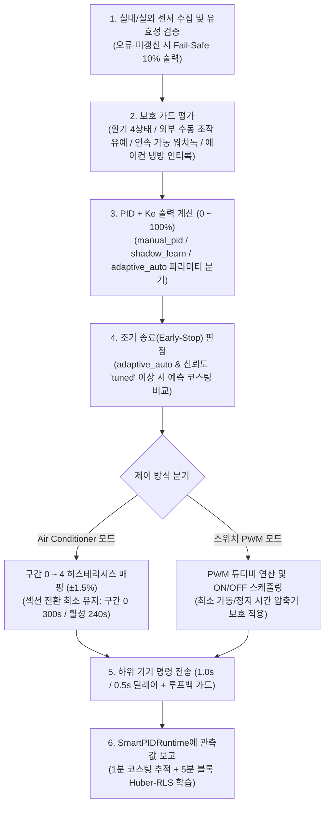

# Smart PID Air Conditioner & Thermostat (`smart_pid_airconditioner`)

Home Assistant용 **지능형 냉방·난방·가습·제습 자가학습 PID 통합구성요소(Custom Component)**입니다.

실내 및 실외 온·습도 센서를 기반으로 PID + 외기 피드포워드($K_e$) 출력을 계산하고, 인버터 기기(`climate` / `humidifier`)는 **0~4단계 출력 구간(Section)**으로 정밀 매핑하며, 일반 ON/OFF 기기(`switch` / `input_boolean`)는 **PWM 시간비례 제어**로 구동합니다.
또한 백그라운드 **자가학습 엔진(Huber-RLS + 동적 코스팅 + Skogestad SIMC)**과 **4상태 환기 감지기**, **수동 조작 유예 및 안전 워치독**을 통해 오버슈트를 억제하고 공간 특성에 맞게 제어 파라미터를 스스로 최적화합니다.

---

## 🌟 주요 기능 및 특징

### 1. 다양한 제어 기기 및 모드 지원
- **에어컨 / 보일러 (`climate`, Air Conditioner 모드)**:
  - 냉방(`cool`), 난방(`heat`), 냉/난방 겸용(`heat_cool`), 자동(`auto`), 송풍(`fan_only`), 제습(`dry`) 지원.
  - 하위 기기가 실제로 지원하는 운전 모드(`hvac_modes`) 및 팬 속도(`fan_modes`)를 자동 조회해 유효한 항목만 노출합니다.
- **가습기 / 제습기 (`humidifier`, Air Conditioner 모드)**:
  - 가습(`humidifier`), 제습(`dehumidifier`), 가습/제습 겸용(`humidity_dehumidity`) 지원.
  - 하위 기기 지원 `mode` 목록 자동 조회 및 명령 안정성 순서(`turn_on` → `set_mode` → `set_humidity`) 보장.
- **스위치 / 릴레이 (`switch_pwm`, PWM 모드)**:
  - 일반 ON/OFF 스위치·릴레이를 설정된 PWM 주기 내 듀티비(%)로 시간비례 제어하며, **최소 가동 시간(`min_on_time`)·최소 정지 시간(`min_off_time`)**으로 압축기 보호를 지원합니다.
  - 냉방/난방 겸용 및 가습/제습 겸용 스위치(개별 엔티티 지정) 시 **최소 데드밴드(`2.0°C` / `5.0% RH`)**로 동시 교차 가동을 방지합니다.

### 2. 안정적인 PID 연산 및 통신 보호
- **Derivative Kick 방지 & 1차 LPF 미분항**: 설정값 변경 시 미분 충격을 피하기 위해 측정값 변화율($\Delta T_{\text{room}}, \Delta H_{\text{room}}$)을 사용하며, `10초` 미만 급격한 센서 노이즈 이벤트를 차단하고 1차 저역통과필터($\tau_d = 120\text{초}$)를 적용합니다.
- **분 단위 적분(`Ki`) & 양방향 제한(`±Max I`)**: 연산 주기와 무관하게 분 단위로 적분항을 정규화하고, 적분항이 `[-Max I, +Max I]` 범위를 넘지 않도록 양방향 클램핑 및 포화 시 안티 와인드업(Anti-windup)을 적용합니다.
- **외기 피드포워드($K_e$)**: 실외 센서 미설정 시 자동으로 $0.0$ 처리되며, 설정 시 외기 편차를 보상해 외기 변화에 선제 대응합니다.
- **구간 전환 & 다중 명령 딜레이 + 스위치 명령 가드 (`SwitchCommandGuard`)**: 구간 전환 시 첫 명령 전 `1.0초`, 다중 명령(전원·모드·목표값·팬) 간 `0.5초` 지연과 `_is_dispatching` 재진입 가드로 Zigbee/IR/Wi-Fi 기기의 명령 유실을 방지합니다. PWM 스위치는 `OFF` 명령 시 대기 중인 `ON`을 선점 취소하고 상태 확인(`1.5초`)·제한적 재시도(`0.3s`, `0.7s`)·`ON` 실패 시 안전 `OFF` 복구를 수행하며, 일시적(`60초` 미만) 통신 단절(`unavailable`/`unknown`) 중에는 기존 `_pwm_state`를 보호합니다.

---

## 🏗️ 전체 동작 구조 (제어 아키텍처)

매 제어 주기(`sample_period`, 기본 `60초`) 또는 유효 센서 상태 변경 시 아래 파이프라인 순서로 동작합니다.



### 제어 방식별 세부 동작
1. **Air Conditioner 모드 (`climate_delta`) — 구간 0 ~ 구간 4 매핑**
   - PID 출력(`0~100%`)을 4개의 활성 구간(`구간 1` < `구간 2` < `구간 3` < `구간 4`)으로 나누고, `±1.5%` 히스테리시스 밴드로 경계 떨림(채터링)을 방지합니다.
   - 각 구간별로 **목표값 보정(Delta 오프셋)**, **팬 속도**, **운전 모드**, **전원(가습/제습)** 적용 여부를 개별 설정할 수 있습니다.
   - PID 출력이 저출력 임계값(`5%`) 이하로 떨어지거나, 환기·워치독·조기 종료 조건이 충족되면 **구간 0 (`section_0`) 대기/조기 종료 상태**로 진입합니다:
     - `목표값 셋백 대기 (setback)`: 목표 온/습도에 여유 오프셋(`sec0_delta`)을 더해 컴프레서를 저부하 대기로 전환
     - `송풍 전환 (fan_only)`: 송풍 모드로 전환하여 공기 순환 유지
     - `기기 끄기 (off)`: 하위 기기 전원을 꺼서 대기
   - 짧은 주기 잦은 전환을 막기 위해 구간 0 진입 후 최소 `300초(5분)`, 활성 구간 진입 후 최소 `240초(4분)`의 최소 유지시간을 보장합니다.
2. **PWM 모드 (`switch_pwm`)**
   - `pwm_duration`(기본 `900초`) 주기 중 `PID 출력(%)` 비율만큼 스위치를 켜고 나머지는 끕니다.
   - 계산된 ON/OFF 시간이 `min_on_time` / `min_off_time`(기본 각 `180초`) 미만이면 보호 규칙에 따라 스킵하거나 최소 시간을 보장합니다.

---

## 🧠 자가학습 원리

자가학습 엔진(`SmartPIDRuntime`, `learner.py`, `psychrometrics.py`, `storage.py`)은 외부 라이브러리 없이 순수 Python으로 작성되어 1분 주기로 동작하며, 제어 로직과 분리되어 안전하게 백그라운드에서 학습합니다.

### 1. 4단계 동적 코스팅 학습 (`DynamicCoastingLearner`, 1분 주기)
기기가 꺼지거나 대기(`section_0`)로 전환된 직후에도 배관·열교환기·바닥 축열체의 잔열/잔냉(코스팅, Afterglow) 때문에 온·습도가 추가로 변하는 현상을 추적합니다.
- **상태 전이**: `대기 (idle)` → `가동 중 (active)` → `정지 후 코스팅 관찰 (post_stop_coast)` → `자연 변화 관찰 (passive_drift)`
- **관성 프로파일 (`inertia_profile`)**:
  - **빠른 공기 순환 (`fast_air`)**: 에어컨, 팬히터, 가습기, 제습기 등 공기를 직접 순환시키는 기기용 (시정수 `10분`, 최대 코스팅 관찰 `45분`). 정지 직전 변화 기울기(`slope`)와 감쇠 시정수(`tau_coast`) 기반 예측.
  - **고관성 축열 (`high_inertia`)**: 온돌 바닥난방·라디에이터용 (시정수 `35분`, 최대 코스팅 관찰 `180분`). 1차 지연 가상 축열량(`emitter_charge`)을 적분해 정지 후 방출되는 잔열 코스팅량 예측.
  - **사용자 지정 (`custom`)**: 특수 공조기·팬코일·벽난로/복합 난방 등에 맞춰 **사용자 지정 코스팅 관찰 최대 창(`custom_coast_window_min`, 15~720분, 기본 90분)** 및 **열 시상수 τ(`custom_tau_em_min`, 5~180분, 기본 25분)**를 직접 지정할 수 있는 축열형 프로파일.
- **정밀 정점 확정 & 품질 필터**:
  - **2단계 연속 반전 정점 확정 (`peak_confirm_delta`)**: 단일 센서 흔들림으로 코스팅 정점을 조기 종료하지 않고 2회 연속 반전 시에만 정점을 확정합니다.
  - **이상치 격리/재현 검증**: 과거 중앙값 대비 극단적 코스팅은 1회 발생 시 `inconsistent_coast_outlier`로 격리 보류하고 유사 패턴이 2회 재현될 때만 학습에 반영합니다.
  - **다중 오염 가드**: 가동 `5분` 미만(`short_run`), **환기/수동 조작**, **`60초` 초과 기기 `unavailable`(`device_unavailable`)**, 주간 난방 중 햇빛 유입(`solar_guard` 활성화 시 `sun.sun` 일출 상태 급등 차단)이 개입된 사이클은 폐기하고 유효 사이클만 **EWMA($\alpha=0.25$)**로 갱신합니다.

### 2. 5분 블록 `Huber-RLS` 온라인 열·수분 모델 추정
`1분` 단위 관측치를 `5분` 블록으로 평균 내어 공간의 열·수분 동특성 방정식을 실시간 회귀 추정합니다.
$$\frac{dy}{dt} = \theta_0 \cdot u - \theta_1 \cdot (y_{\text{in}} - y_{\text{out}}) \; [+ \; \theta_2 \cdot u_{\text{aux\_heat}}]$$
- $\theta_0$ (`learned_rate`): 100% 가동 시 분당 온·습도 변화 능력 (`°C/min` 또는 `g/m³·min`)
- $\theta_1$ (`learned_loss`): 실내외 편차에 따른 외피 손실(단열) 계수 (`1/min`)
- $\theta_2$: 동일 공간에 제습기(`coupled_dehumidifier`)가 함께 가동될 때 발생하는 압축기 발열 보상항
- **이상치 이중 차단**: 단기 센서 튐이나 문 개방 등 외란이 모델 망각 계수(`0.992`)를 망가뜨리지 않도록 `huber_delta=0.04` 가중치 감쇠 및 `hard_reject=0.12` 초과 오차 샘플 즉시 기각을 수행합니다. 또한 환기·수동 조작이 1분이라도 포함된 5분 블록은 통째로 학습에서 제외합니다.

### 3. 가습·제습 절대습도(AH) 정밀 학습 (`psychrometrics.py`)
상대습도(`RH%`)는 실내 온도가 `1°C`만 변해도 크게 출렁이므로, **보조 실내 온도 센서(`aux_temp_sensor`)**가 지정된 경우 Bolton(1980) 포화수증기압 공식으로 **절대습도($\text{g/m}^3$)**로 변환해 온도와 무관한 순수 수분량 변화를 학습합니다. 보조 온도 센서가 없거나 `unavailable`이면 안전하게 `RH%` 기반 폴백 학습을 수행합니다.

### 4. `Skogestad SIMC` 자동 튜너 (`SimcAutoTuner`)
학습된 FOPDT 모델($K, \tau, \theta$)로부터 Skogestad SIMC 규칙으로 최적의 $K_p, K_i, K_e$ 추천값을 산출합니다.
- **예측 성향 (`prediction_mode`)**: 닫힘 루프 시정수 $\tau_c$ 배수를 조절해 목표 추종 성향을 결정합니다 (`절전(eco)` $2.0\theta$ · `균형(balanced)` $1.5\theta$ · `쾌적(comfort)` $1.0\theta$).
- **드리프트 안전 클램핑**: 수동 설정 기준값 대비 **±50%** 범위 내로만 자동 추천값을 제한해 급격한 발산을 방지합니다.

### 5. 영구 저장 및 과거 이력 부트스트랩 (Recorder & InfluxDB v1)
- 학습 모델(`temp_rls`, `hum_rls`, 코스팅 이력, 안전 스냅샷)은 `.storage/smart_pid_airconditioner.<entry_id>`에 **`10분(600초)` 디바운싱 저장**되어 SD 카드/SSD 쓰기 마모를 최소화하며 HA 재시작 후에도 유지됩니다.
- `recorder_bootstrap` 옵션을 켜면 최초 설치 시 과거 `3일`간의 HA Recorder 이력을 읽어 초기 모델 추정치를 빠르게 형성합니다.
- 2~3년 치 장기 데이터가 InfluxDB v1(HA Add-on 등)에 축적된 경우 **`smart_pid_airconditioner.bootstrap_from_influxdb`** 서비스를 호출하면 30일 단위 청크 분할 조회와 실내 온·습도 구간 필터링을 통해 비가동 계절을 제외하고 즉시 자가학습 모델을 구축할 수 있습니다.

---

## 🔄 학습 단계 및 학습 이후 동작 변화

튜닝 모드(`tuning_mode`)에 따라 학습 데이터 활용 방식이 명확히 구분됩니다.

| 튜닝 모드 | 실제 PID 제어 동작 | 백그라운드 학습 | 권장 사용 시점 |
| :--- | :--- | :---: | :--- |
| **수동 PID (`manual_pid`)** | 사용자가 입력한 $K_p, K_i, K_d, K_e$ 그대로 제어 | ❌ 중지 | 자가학습 없이 고정 PID만 쓰고 싶을 때 |
| **관찰 학습 (`shadow_learn`, 기본값)** | **수동 PID와 100% 동일한 명령** 출력 (제어 개입 0%) | ⭕ 진행 | 설치 직후 ~ 학습 신뢰도가 `자동 제어 준비 완료`에 도달할 때까지 |
| **자가학습 자동 제어 (`adaptive_auto`)** | 신뢰도 충족 시 SIMC 추천 $K_p/K_i/K_e$ 적용 + 예측 코스팅 **조기 종료** 활성화 | ⭕ 지속 보정 | 신뢰도가 **`자동 제어 준비 완료 (tuned)`** 이상일 때 |

### `adaptive_auto` 전환 후 실제로 달라지는 점
1. **신뢰도 게이팅 (안전 대기)**:
   - 신뢰도가 `데이터 수집 중 (collecting)` 또는 `기초 안정화 (stable)` 단계일 때는 `adaptive_auto`를 선택하더라도 섣불리 개입하지 않고 **수동 PID 값을 그대로 유지**합니다 (`fallback_reason: insufficient_valid_cycles`).
   - 유효 코스팅 사이클 **10회 이상** + RLS 샘플 **20개(유효 5분 블록 20회 = 약 100분) 이상**이 누적되어 **`자동 제어 준비 완료 (tuned, 70%↑)`** 단계에 도달하면 자동 제어로 매끄럽게 전환됩니다.
2. **예측 코스팅 기반 조기 종료 (오버슈트 억제)**:
   - 현재 목표와의 잔여 오차(`error`)가 **`예측 코스팅량`** 이하로 좁혀지면 목표 도달 전에 미리 정지/대기합니다.
   - **PWM 모드**: 사이클을 미리 종료(`OFF`)해 잔열·잔냉으로 목표 온/습도에 정확히 안착시킵니다.
   - **Air Conditioner 모드**: 활성 구간 최소 유지시간(`240초`) 이후 즉시 **구간 0 (`section_0`)**으로 전환해 불필요한 과냉·과열을 막습니다.
3. **자동 파라미터 적용 & 실시간 MAE 기반 5사이클 자동 롤백 보호**:
   - 계절당 최대 5회(전체 20회) 한도 내에서 새 SIMC 파라미터 적용 시 직전 파라미터와 성능 기준선(`baseline_mae`, `baseline_overshoot`)을 스냅샷 저장합니다.
   - 완료된 코스팅 사이클마다 실측 예측 오차(`mean_absolute_error`)와 오버슈트를 실시간 집계하며, 적용 후 **5사이클 동안 MAE 또는 오버슈트가 30% 초과 악화**되면 즉시 직전 안정 파라미터로 **자동 롤백**하고 Home Assistant **영구 알림(Persistent Notification)**으로 알려줍니다.

---

## 🛠️ 실질적인 사용 방법 (단계별 실전 가이드)

### 1단계: 설치 및 초기 설정 (`관찰 학습` 시작)
1. **설정 > 기기 및 서비스 > 통합구성요소 추가 > Smart PID Air Conditioner**에서 제어 방식과 기기 유형을 선택합니다.
2. 기기/센서와 기본 PID 파라미터($K_p, K_i, \text{Max } I, K_d, K_e$)를 입력합니다.
   - *Tip*: `Ki` 우측의 **적분 제한 범위 (`Max I, ±%`)**를 기본 `20%` 정도로 두면 외란 시 적분 포화(Windup)를 막아 반응이 훨씬 안정적입니다.
3. **스마트 자가학습 및 안전 보호 (선택)** 섹션을 열어 기본 설정을 확인합니다:
   - **튜닝 모드**: 기본값 **`관찰 학습 (shadow_learn)`** 유지 권장 (기존 수동 설정과 100% 동일하게 동작하면서 안전하게 공간 데이터를 축적합니다).
   - **건물/기기 열 관성 프로파일**:
     - 에어컨·팬히터·가습기·제습기 → **`빠른 공기 순환 (fast_air)`**
     - 온돌 바닥난방·라디에이터 → **`고관성 축열 (high_inertia)`**
     - 특수 설비/별도 시간 조정이 필요한 경우 → **`사용자 지정 (custom)`** 선택 후 **코스팅 관찰 최대 창(`15~720분`, 기본 90분)** 및 **열 시상수 τ(`5~180분`, 기본 25분)** 직접 입력
   - **(선택) 일사량 가드 (`solar_guard`)**: 햇빛이 강하게 드는 난방 공간에서는 활성화해 낮 시간 창가 온도 급등을 잔열 코스팅으로 오학습하지 않도록 보호하세요.
4. **(Air Conditioner 모드)** 3단계 구간 설정에서 **구간 0 (`section_0`)**의 대기 동작(`목표값 셋백 대기` / `송풍 전환` / `기기 끄기`)과 셋백 오프셋(예: 냉방 `+2.0°C`, 난방 `-2.0°C`)을 확인합니다.

### 2단계: 환기 감지 & 안전 보호 & 교차 연동 설정
- **환기 감지 및 학습 보호**:
  - 창문/문 접촉 센서(`binary_sensor`)나 환기 스위치가 있다면 **환기 감지 모드**를 `다중 창문/문 센서` 또는 `스위치`로 지정하세요.
  - 창문을 열면 **열림 디바운스**(기본 `45초`) 후 `환기 중` 상태가 되어 기기를 잠시 멈추고 적분항을 동결하며, 창문을 닫으면 제어는 즉시 재개하되 **닫힘 후 학습 쿨다운**(기본 `20분`) 동안 벽체 반등 구간이 학습 모델을 오염시키지 않도록 보호합니다.
- **수동 조작 유예 & 워치독**:
  - 리모컨이나 다른 대시보드에서 직접 온도·모드를 바꾸면 **외부 수동 조작 유예**(기본 `30분`) 동안 자동 제어를 멈추어 사용자 의도를 존중합니다.
  - **최대 연속 가동 워치독**(기본 `120분`)과 **강제 휴지 시간**(기본 `15분`)으로 냉방기/제습기 과열이나 결빙을 예방할 수 있습니다.
- **동일 공간 기기 교차 연동**:
  - 에어컨과 제습기를 같은 방에 둔 경우, 에어컨 설정에는 `coupled_dehumidifier`(제습기 발열 보상), 제습기 설정에는 `coupled_ac`(에어컨 냉방 가동 시 인터록)를 연결하면 두 기기가 서로의 학습을 방해하지 않습니다.
  - 가습/제습 제어 시 같은 방 온도 센서를 `aux_temp_sensor`에 지정하면 절대습도 기준으로 학습 정밀도가 올라갑니다.

### 3단계: 진단·설정 엔티티 모니터링 및 진단 다운로드
기기가 가동되면서 제어기 기기 화면에 **5종 진단 센서(`DIAGNOSTIC`)**와 **3종 실시간 설정 엔티티(`CONFIG`)**가 함께 생성됩니다.

| 엔티티 이름 (분류) | 표시 상태값 / 역할 | 핵심 속성(Attributes) 및 해석 포인트 |
| :--- | :--- | :--- |
| **학습 신뢰도** (진단) | `0 ~ 100%` | `학습 단계`: `데이터 수집 중`(0~49%) → `기초 안정화`(50~69%) → **`자동 제어 준비 완료`**(70~89%) → `최적화 완료`(90~100%)<br/>`rls_samples`, `rejected_outliers`, **`mean_absolute_error`**, **`comparison_count`**, `last_predicted_coast` / `last_observed_coast` |
| **사이클 단계** (진단) | `대기` / `가동 중` / `정지 후 코스팅 관찰` / `자연 변화 관찰` | `accepted_count`, `rejected_counts`, `열 관성 프로파일`, **`tau_em_min`**, **`max_coast_window_min`** |
| **예측 코스팅량** (진단) | `°C` / `g/m³` / `%` | 기기 정지 후 잔열/잔냉으로 추가로 변동할 것으로 예측되는 양 |
| **자동 추천 제어 파라미터** (진단) | 추천 `Kp` | `recommended_ki`, `recommended_ke`, `learned_rate`, `learned_loss`, `fallback_reason` |
| **환기 상태** (진단) | `정상` / `열림 감지 대기` / `환기 중 (제어 일시정지)` / `닫힘 후 학습 안정화` | `cooldown_remaining_seconds`, `should_pause_control`, `should_block_learning`, `degraded` (센서 5분 이상 불능 시) |
| **자가학습 튜닝 모드** (설정 Select) | `수동 PID` / `관찰 학습` / `자가학습 자동 제어` | **통합구성요소 리로드 없이** 튜닝 모드를 즉시 전환 |
| **예측 제어 성향 (SIMC)** (설정 Select) | `절전` / `균형` / `쾌적` | **통합구성요소 리로드 없이** 제어 성향 즉시 전환 및 추천 파라미터 재계산 |
| **자가학습 초기화** (설정 Button) | 버튼 클릭 | 클릭 즉시 누적 학습 데이터, 코스팅 이력, MAE 및 안전 스냅샷 초기화 |

> **진단 정보 다운로드**: 기기 화면 메뉴에서 **진단 다운로드(Download Diagnostics)**를 누르면 현재 설정, `mean_absolute_error`, RLS 모델 및 코스팅 이력이 포함된 JSON 파일을 바로 내려받아 분석할 수 있습니다.

### 4단계: `자가학습 자동 제어 (adaptive_auto)` 전환
1. **학습 신뢰도**가 `70%` 이상이고 속성 **학습 단계**가 **`자동 제어 준비 완료`**(또는 `최적화 완료`)가 되면 기기 화면의 **자가학습 튜닝 모드** Select 엔티티(또는 옵션 메뉴)에서 **`자가학습 자동 제어 (adaptive_auto)`**로 즉시 전환할 수 있습니다(리로드 불필요).
2. 환경에 맞게 **예측 제어 성향 (SIMC)**을 실시간 조정합니다:
   - 에너지 절감 및 스위칭 최소화가 중요하다면 → **`절전 (eco)`**
   - 일반적인 주거 환경 → **`균형 (balanced)`**
   - 빠른 목표 온·습도 도달이 중요하다면 → **`쾌적 (comfort)`**

### 5단계: 공간 구조 변경·기기 교체 시 초기화
에어컨/제습기를 새 기기로 교체했거나 방 구조·창호 단열이 크게 바뀐 경우, 기기 화면의 **`자가학습 초기화` 버튼**을 누르거나 개발자 도구 > 동작(서비스)에서 **`smart_pid_airconditioner.reset_learning`**을 호출하면 해당 엔티티의 누적 모델과 스냅샷을 깨끗하게 초기화해 처음부터 다시 학습할 수 있습니다.

### 6단계 (선택): InfluxDB v1 2~3년 치 과거 데이터로 즉시 사전 학습
이미 Home Assistant Add-on 등의 InfluxDB v1에 과거 데이터가 쌓여 있다면 **개발자 도구 > 동작**에서 `smart_pid_airconditioner.bootstrap_from_influxdb`를 실행해 설치 첫날부터 모델을 완성할 수 있습니다. (먼저 `dry_run: true`로 유효 분 수와 추천 파라미터를 미리 확인한 뒤 `dry_run: false`로 반영하세요.)

```yaml
action: smart_pid_airconditioner.bootstrap_from_influxdb
data:
  entity_id: climate.living_room_boiler
  url: "http://a0d7b954-influxdb:8086"
  database: "homeassistant"
  days: 730
  min_indoor_temp: 16.0
  max_indoor_temp: 23.5
  dry_run: true
```
- **계절 분리(Regime Segmentation)**: 지정한 온·습도 `[min, max]` 범위를 벗어나거나 30분을 초과해 센서가 결측되면 진행 중인 사이클과 5분 RLS 블록을 즉시 단절(`IDLE` 리셋)해 여름·겨울 간 가짜 기울기가 섞이지 않으며, 이미 학습된 계절 계수는 유지해 여러 해의 동일 계절을 누적 학습합니다.
- **자동 탐색 & 호환성**: measurement를 비우면 유형별 후보(`°C`, `°F`, `%`, `state`, `switch`, `input_boolean` 등)와 도메인 제거/포함 `entity_id` 태그를 자동 탐색하며, 스위치 `1/0` 숫자 이력·습도 `rh_to_ah()` 절대습도 변환·환기 20분 쿨다운 차단을 모두 반영합니다.

---

## 📁 디렉토리 구조

```text
custom_components/smart_pid_airconditioner/
├── __init__.py           # 통합구성요소 셋업, v1→v2 마이그레이션, reset_learning · bootstrap_from_influxdb 등록
├── actuator.py           # SwitchCommandGuard (OFF 선점 취소, 상태 확인, 제한적 재시도, 안전 OFF 복구)
├── button.py             # EntityCategory.CONFIG 자가학습 초기화 버튼 엔티티
├── climate.py            # ClimateEntity 제어기 (에어컨/히터/겸용 PID, 구간 0~4 및 PWM 디스패처)
├── config_flow.py        # UI 설정(ConfigFlow) 및 옵션(OptionsFlowWithReload) 마법사
├── const.py              # 상수, 기본값, 도메인 및 시간 변환 유틸리티
├── diagnostics.py        # Home Assistant Download Diagnostics(진단 정보 JSON 다운로드)
├── humidifier.py         # HumidifierEntity 제어기 (가습기/제습기 PID 및 디스패처)
├── influxdb_bootstrap.py # InfluxDB v1 30일 청크 분할 조회 및 계절 필터 기반 과거 이력 사전 학습 엔진
├── learner.py            # 순수 Python 자가학습 엔진 (Huber-RLS, 2단계 정점·이상치 격리 코스팅, SIMC, SafetyManager)
├── psychrometrics.py     # Bolton(1980) 상대습도 ↔ 절대습도(g/m³) · 이슬점 변환
├── runtime.py            # SmartPIDRuntime (1분 코스팅/5분 RLS 루프, 일사량/통신불능 가드, MAE 롤백, Select 전환)
├── select.py             # EntityCategory.CONFIG 리로드 없는 튜닝/예측 모드 Select 엔티티 2종
├── sensor.py             # EntityCategory.DIAGNOSTIC 진단 센서 5종
├── services.yaml         # reset_learning 및 bootstrap_from_influxdb 서비스 스키마
├── storage.py            # ModelStore (10분 디바운싱 .storage 영구 저장 및 스냅샷 직렬화)
├── ventilation.py        # 4상태 환기 감지기 (디바운스, 쿨다운, 센서 불능 유예)
├── manifest.json         # 통합구성요소 메타데이터
├── strings.json          # 기본 UI/엔티티 리소스 (한국어)
└── translations/
    ├── en.json           # 영어 번역 리소스
    └── ko.json           # 한국어 번역 리소스
```

---

## 🚀 설치 방법

### 수동 설치
1. `custom_components/smart_pid_airconditioner` 폴더를 Home Assistant의 `config/custom_components/` 디렉토리에 복사합니다.
2. Home Assistant를 재시작합니다.
3. **설정 > 기기 및 서비스 > 통합구성요소 추가**에서 **Smart PID Air Conditioner**를 검색하여 추가합니다.

### HACS 설치 (사용자 정의 저장소)
1. HACS > 통합구성요소 > 우측 상단 메뉴 > **사용자 정의 저장소 추가**
2. 저장소 URL: `https://github.com/myrayearth/Smart_Pid_Airconditioner`
3. 범주: **통합구성요소 (Integration)**
4. 다운로드 후 Home Assistant를 재시작합니다.
